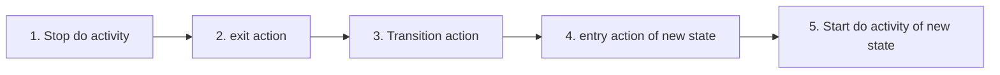

## 1. The sequence

When an event triggers a transition out of a state, UML runs things in this order:

1. The **`do` activity is stopped** (aborted), if it is still running.
2. The state's **`exit` action** runs.
3. The **transition's own action** (the `/ action` on the arrow) runs, if there is one.
4. The **new state's `entry` action** runs.
5. The new state's `do` activity starts.



---

## 2. Example

An ATM state `Serving Customer`:

```
┌──────────────────────────────────┐
│        Serving Customer          │
├──────────────────────────────────┤
│ entry / readCard                 │
│ do / processTransaction          │
│ exit / ejectCard                 │
└──────────────────────────────────┘
        │
        │ cancel / printReceipt
        ▼
     [ Idle ]
```

The customer presses **Cancel** while `processTransaction` is still running:

| Step | What happens |
|---|---|
| 1 | `processTransaction` (the `do` activity) is **interrupted**. It does not have to finish. |
| 2 | `ejectCard` (the `exit` action) runs. |
| 3 | `printReceipt` (the transition's action) runs. |
| 4 | The object is now in `Idle`, and any `entry` action of `Idle` runs. |

---

## 3. Why the do activity stops first

A `do` activity is ongoing work tied to being **inside** the state. Once the object has decided to leave, that work no longer belongs anywhere, so it ends before the exit action runs.

```java
// Inside the state
startDoActivity();           // do: processTransaction (runs while in the state)

// An event triggers a transition out
abortDoActivity();           // 1. do activity stopped
exitAction();                // 2. exit: ejectCard
transitionAction();          // 3. transition effect: printReceipt
enterNewState();             // 4. entry of the next state
```

---

## 4. Entry and exit vs do

| | `entry` / `exit` | `do` |
|---|---|---|
| Nature | A short **action** that runs to completion | An **ongoing activity** that may take a long time |
| Interruptible? | **No**, it finishes | **Yes**, it can be cut short |
| Can change the object's state? | Yes | No |

Because `do` activities cannot change the object's state, interrupting one does not corrupt the object. That is why UML allows aborting them when the state is exited.

---

## 5. How a do activity ends

A `do` activity normally ends in one of two ways:

- **It completes by itself.** For example, `do / Read Account Balance` finishes the read.
- **The state is exited.** A transition fires, and the activity is aborted.

If a `do` activity completes while no event has happened, the object stays in the state until an event, or a completion transition, moves it on.

---

## 6. Exam tips

1. **"Do-activities cannot be aborted by any event" is false.** They may be interrupted.
2. **"An event triggering a transition that leaves the current state aborts the do-activity" is true.**
3. **"Internal behaviours trigger transitions" is false.** Events trigger transitions, and internal behaviours (`entry`, `do`, `exit`) run inside a state.
4. **The `exit` action runs after the `do` activity stops**, and before the new state's `entry` action.
