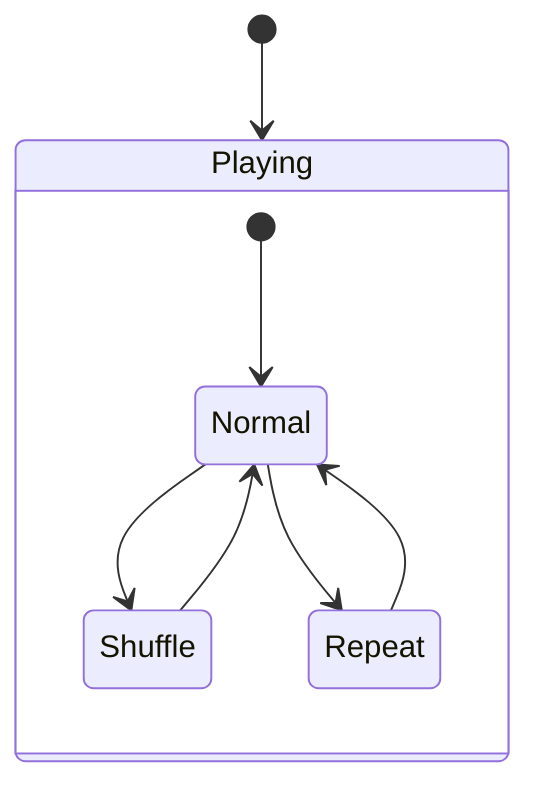
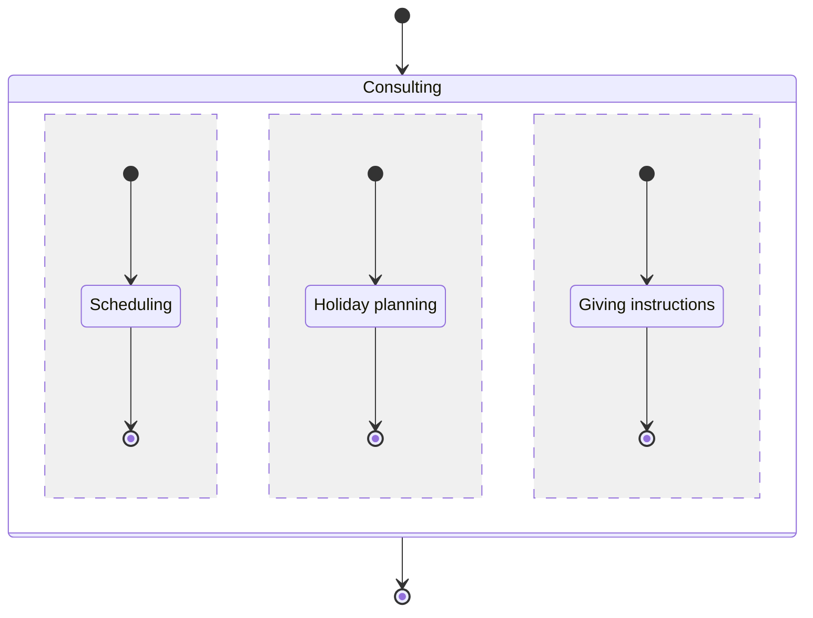

## 1. What is a composite state?

A **composite state** is a state that contains other states (**sub-states**). The sub-states live inside one or more **regions**, which are compartments that hold their own sub-states and transitions.

UML has two kinds of composite state, decided by **how many regions** it has:

- **Simple composite state:** exactly **one** region.
- **Orthogonal composite state:** **two or more** regions.

---

## 2. Simple composite state

- It has exactly **one region**.
- Only **one sub-state is active at a time**, so the sub-states are **sequential or mutually exclusive**.
- Entering the composite state activates one sub-state, usually through a single initial state.

**Example:** a `Playing` state in a music player with the sub-states `Normal`, `Shuffle` and `Repeat`. Only one is active at any moment, and switching moves you out of one and into another.

---

## 3. Orthogonal composite state

- It has **two or more regions**, drawn separated by **dashed lines**.
- The regions are **concurrent (parallel)**. When the composite state is entered, **one sub-state in every region is active at the same time**.
- Each region has its **own initial state and its own final state**.

**Example:** a `Consulting` state with the regions `Scheduling`, `Holiday planning` and `Giving instructions`. All three run at once, and each region progresses independently.

**How it exits:** the outgoing transition normally fires only when **all regions** have reached their final states (a **join**), unless it is triggered by an event.

---

## 4. Comparison

| | Simple composite | Orthogonal composite |
|---|---|---|
| Regions | **1** | **2 or more** (dashed lines) |
| Active sub-states at once | **One** | **One per region** |
| Behaviour | Sequential or exclusive | Concurrent (parallel) |
| Initial state | One | One per region |
| Exit | When its single flow ends or an outgoing transition fires | Normally when **all regions** reach their final states |

---

## 5. Exam tips

1. **"Orthogonal" means parallel or concurrent, not sequential.** An orthogonal composite state with three *sequential* states is wrong, while one with three *parallel* states is right.
2. **The number of regions decides the type.** Dashed lines mean the state is orthogonal. A state with parallel behaviour but only one region is not an orthogonal composite state, and a "simple composite state with three parallel states" cannot exist, since simple means one region.
3. **Completion needs every region.** An orthogonal composite state is complete only when all of its regions have finished.
