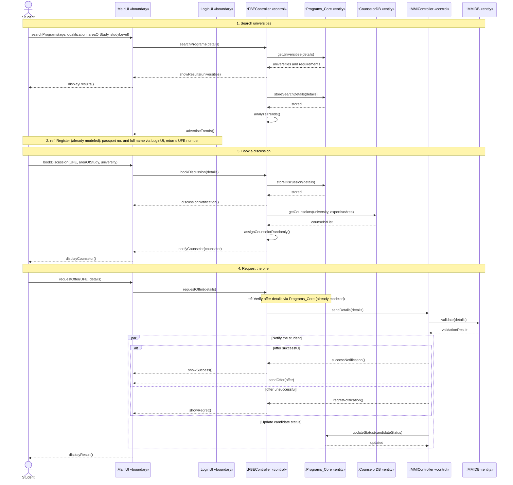

## 1. Question summary

Analyze the partial requirements of the **Full Bright Education (FBE)** enrollment process and draw a **sequence diagram** (25 marks), using suitable **boundary, control and entity classes**.

The process has four parts:

1. Search for universities and enrollment requirements.
2. Register (**already modeled**, so it is shown as a `ref`).
3. Book a discussion and get a counselor assigned.
4. Request an offer (offer verification is **already modeled**, so it is also a `ref`), which is validated by the third-party IMMI portal.

---

## 2. Lifelines

| Lifeline | Type | Source in the scenario |
|---|---|---|
| Student | Actor | "Any student can search..." |
| `:MainUI` | Boundary | Displays results, takes booking and offer requests |
| `:LoginUI` | Boundary | Used for registration (already modeled) |
| `:FBEController` | Control | "The FBE system", which coordinates everything |
| `:Programs_Core` | Entity | Stores search details, discussions and candidate status |
| `:CounselorDB` | Entity | Counselor details and expertise areas |
| `:IMMIController` | Control | The third-party portal's controller (IMMI.gov.uk) |
| `:IMMIDB` | Entity | IMMI database used for validation |

---

## 3. Sequence diagram

---

## 4. Points that earn marks

- **Boundary, control and entity classes** are used, as the note in the question allows.
- **`ref` fragments** stand in for registration and offer verification, since the paper says they are "already modeled for reuse". Do not redraw them. In Mermaid they appear as notes, but on paper draw a proper `ref` box.
- **`alt` fragment** for the successful vs unsuccessful offer, since the IMMI controller "may send" a success notification or a regret notification.
- **`par` fragment** because the IMMI controller updates the status "simultaneously" with notifying the student.
- **Self-messages** for `analyzeTrends()` and `assignCounselorRandomly()`, since these are processing steps inside the controller.
- **The offer goes directly from IMMI to MainUI**, while the notification goes through the FBE system. The paper words the two paths differently, so draw them differently.
- **Message order** follows the text: search, register, book, then offer.
