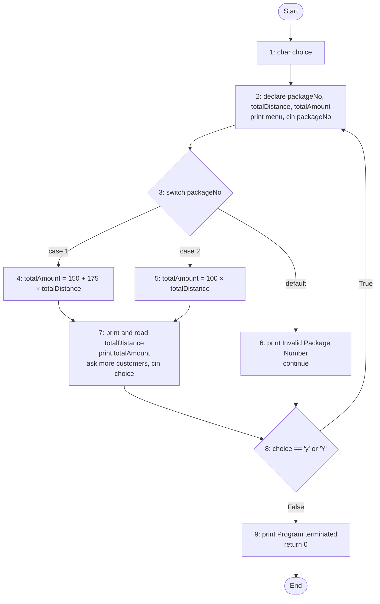

## 1. Method used

Both parts follow the method in Lecture 08 (Software Testing):

$$\text{Statement coverage} = \frac{\text{No. of executed statements}}{\text{Total no. of statements}} \times 100\%$$

$$\text{Branch coverage} = \frac{\text{No. of executed branches}}{\text{Total no. of branches}} \times 100\%$$

- Statement coverage counts **each line**, including `else`, as the lecture's worked example does.
- A **branch** is each true/false outcome of a decision (each `case` of a `switch` counts as a branch).

---

## 2. Part 1: Branch coverage (C++ code)

### a) Control flow graph

In a `do-while` loop, `continue` jumps to the loop **condition**, not to the top. That is why the default case goes to node 8.

### b) Number of branches

| Decision | Branches |
|---|---|
| `switch (packageNo)` | case 1, case 2, default = **3** |
| `while (choice == 'y' \|\| choice == 'Y')` | True, False = **2** |
| **Total** | **5** |

### c) packageNo = 2, choice = 'n'

- Branches covered: **case 2** and **loop False**.
- Branch coverage = $\frac{2}{5} \times 100 = $ **40%**

### d) packageNo = 6, packageNo = 1, choice = 'n'

- Branches covered: **default**, **loop True** (after `continue`, the loop repeats), **case 1** and **loop False**.
- Case 2 is not covered.
- Branch coverage = $\frac{4}{5} \times 100 = $ **80%**

### e) (1, 'Y'), (6, 'y'), (2, 'n')

- Branches covered: **case 1**, **default**, **case 2**, **loop True** and **loop False**.
- Branch coverage = $\frac{5}{5} \times 100 = $ **100%**

**Notes:**

- In d), `choice` has no value when `continue` jumps to the condition, which is technically undefined behaviour in C++. The question clearly assumes the loop repeats.
- In e), the `'y'` given with packageNo = 6 is never read, because `continue` skips the `cin >> choice` line. The earlier `'Y'` keeps the loop going, and the coverage is the same.

---

## 3. Part 2: Statement coverage (Python code)

### Numbered statements

| # | Line |
|---|---|
| 1 | `i = 3` |
| 2 | `while i < 6:` |
| 3 | `print(i)` |
| 4 | `i += 1` |
| 5 | `if i > 3:` |
| 6 | `print("Three or above three")` |
| 7 | `elif (i == 3):` |
| 8 | `print("three")` |
| 9 | `else:` |
| 10 | `print("Less than three")` |
| 11 | `break` |
| 12 | `print("end of loop")` |

Total statements = **12**

### Results

| Part | Start value | Lines executed | Not executed | Coverage |
|---|---|---|---|---|
| a) | i = 3 | 1, 2, 3, 4, 5, 6, 12 = **7** | 7, 8, 9, 10, 11 | $\frac{7}{12} \times 100 = $ **58.33%** |
| b) | i = 7 | 1, 2, 12 = **3** | everything inside the loop | $\frac{3}{12} \times 100 = $ **25%** |
| c) | i = 2 | 1 to 8, 12 = **9** | 9, 10, 11 | $\frac{9}{12} \times 100 = $ **75%** |
| d) | i = 1 | 1 to 5, 7, 9, 10, 11, 12 = **10** | 6, 8 | $\frac{10}{12} \times 100 = $ **83.33%** |

### How each case runs

- **a)** With i = 3, the first pass makes i = 4, so `if i > 3` is always true. The `elif` and `else` are never reached.
- **b)** With i = 7, `while 7 < 6` is false, so the loop body never runs.
- **c)** With i = 2, the first pass makes i = 3, so the `elif` runs. Later passes make i = 4 and 5, which take the `if` branch.
- **d)** With i = 1, the first pass makes i = 2, so the `else` runs, then `break`, then the final print.

### If `else` is not counted as a statement

The total becomes 11, and the results change to:

| Part | Coverage |
|---|---|
| a) | $\frac{7}{11} \times 100 = $ 63.64% |
| b) | $\frac{3}{11} \times 100 = $ 27.27% |
| c) | $\frac{9}{11} \times 100 = $ 81.82% |
| d) | $\frac{9}{11} \times 100 = $ 81.82% |

The main answers use 12 because Lecture 08's worked example counts `else` as a statement.
