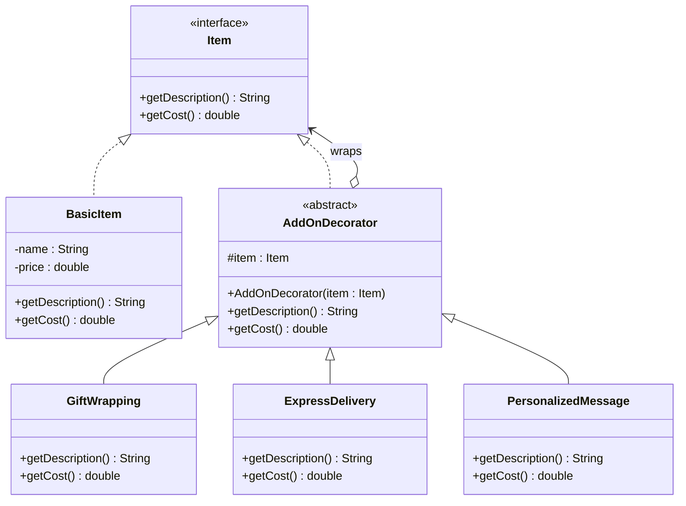

## 1. Suitable design pattern

**Decorator Pattern** (Structural design pattern)

---

## 2. Justification

In the online shopping platform:

- Every item can have **any combination of optional add-ons** (Gift Wrapping, Express Delivery, Personalized Message).
- Each add-on has its own cost, and the **final price must include all selected add-ons**.
- New add-ons must be supported **without changing existing classes**.

The Decorator pattern is ideal because:

- It lets you **attach add-ons to an item dynamically at runtime** by wrapping the item in decorator objects.
- Each decorator adds its own cost on top of the wrapped item's cost, so the **final price is calculated automatically**.
- A new add-on only needs a **new decorator class**, so existing classes stay unchanged (**Open/Closed Principle**).
- It avoids **class explosion**. Without it, every combination would need its own subclass (e.g. `GiftWrappedExpressItem`).
- Decorators implement the same interface as the item, so the client treats a plain item and a decorated item **identically**.

---

## 3. Class structure



**Roles in the pattern:**

| Role | Class |
|---|---|
| Component | `Item` (interface) |
| Concrete Component | `BasicItem` |
| Decorator | `AddOnDecorator` (abstract, holds an `Item` reference) |
| Concrete Decorators | `GiftWrapping`, `ExpressDelivery`, `PersonalizedMessage` |

**Key relationships:**

- `AddOnDecorator` **implements** `Item` and also **contains** an `Item`, which is what allows wrapping.
- Each concrete decorator's `getCost()` returns `item.getCost() + addOnCost`.
- Each concrete decorator's `getDescription()` returns `item.getDescription() + ", Add-on name"`.

---

## 4. Java example

```java
interface Item {
    String getDescription();
    double getCost();
}

class BasicItem implements Item {
    private final String name;
    private final double price;

    BasicItem(String name, double price) {
        this.name = name;
        this.price = price;
    }

    public String getDescription() { return name; }
    public double getCost() { return price; }
}

abstract class AddOnDecorator implements Item {
    protected final Item item;

    AddOnDecorator(Item item) { this.item = item; }

    public String getDescription() { return item.getDescription(); }
    public double getCost() { return item.getCost(); }
}

class GiftWrapping extends AddOnDecorator {
    GiftWrapping(Item item) { super(item); }

    public String getDescription() { return item.getDescription() + ", Gift Wrapping"; }
    public double getCost() { return item.getCost() + 5.00; }
}

class ExpressDelivery extends AddOnDecorator {
    ExpressDelivery(Item item) { super(item); }

    public String getDescription() { return item.getDescription() + ", Express Delivery"; }
    public double getCost() { return item.getCost() + 12.00; }
}

class PersonalizedMessage extends AddOnDecorator {
    PersonalizedMessage(Item item) { super(item); }

    public String getDescription() { return item.getDescription() + ", Personalized Message"; }
    public double getCost() { return item.getCost() + 3.00; }
}

// Usage
Item order = new PersonalizedMessage(
                 new ExpressDelivery(
                     new GiftWrapping(
                         new BasicItem("Watch", 100.00))));

System.out.println(order.getDescription() + " = $" + order.getCost());
// Watch, Gift Wrapping, Express Delivery, Personalized Message = $120.0
```
