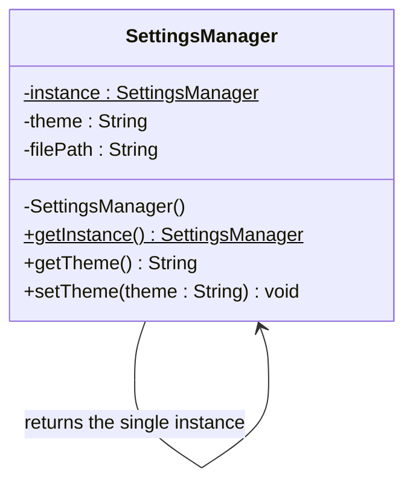

## 1. Suitable design pattern

**Singleton Pattern** (Creational design pattern)

- The settings (file paths, themes, system settings) must stay **consistent across the whole application**, so there must be exactly **one** settings manager.
- The pattern guarantees a **single instance** and provides a **global access point** to it.
- The instance is created **only when first needed** (lazy initialization), as the scenario requires.

---

## 2. Essential components

| Component | Purpose |
|---|---|
| **Private static instance variable** | Holds the one and only `SettingsManager` object (starts as `null`) |
| **Private constructor** | Prevents other classes from creating objects with `new` |
| **Public static method** (`getInstance()`) | Creates the instance on the first call and returns the same one on every later call |

---

## 3. Why the constructor must be private

- If the constructor were public, any class could write `new SettingsManager()` and create **extra instances**, which breaks the "only one instance" rule.
- A private constructor means **only the class itself** can create its object.
- This gives the class **full control** over how many instances exist.

---

## 4. How the global access point works

`getInstance()` is `public static`, so it can be called from anywhere **without creating an object**: `SettingsManager.getInstance()`.

The method:

1. Checks whether the instance already exists.
2. Creates it if it does not (**lazy initialization**).
3. Returns the instance.

It is important because:

- Every module gets the **same object** and sees the same data.
- The object is created **only when first needed**.
- There is no need to pass the settings manager around as a parameter.

---

## 5. If multiple instances were created

**Problems that could occur:**

- **Inconsistent data:** one module changes the theme in its own copy while others still see the old value.
- **Conflicts:** two instances might write to the same config file and overwrite each other.
- **Wasted memory and resources** from loading the settings more than once.
- **Hard-to-trace bugs**, since the state differs depending on which instance was used.

**How Singleton prevents them:**

- The private constructor blocks creation from outside the class.
- `getInstance()` always returns the one existing instance.
- This gives a **single source of truth** for all settings.

---

## 6. Class structure



---

## 7. Java example

```java
public class SettingsManager {
    private static SettingsManager instance;   // starts as null (lazy)

    private String theme = "Light";
    private String filePath = "/config/app.properties";

    private SettingsManager() { }              // private constructor

    public static synchronized SettingsManager getInstance() {
        if (instance == null) {
            instance = new SettingsManager();  // created on first use only
        }
        return instance;
    }

    public String getTheme() { return theme; }
    public void setTheme(String theme) { this.theme = theme; }
}

// Usage
SettingsManager a = SettingsManager.getInstance();
SettingsManager b = SettingsManager.getInstance();
System.out.println(a == b);   // true -> same instance
```

The `synchronized` keyword makes the method **thread-safe**, so two threads cannot create two instances at the same moment.
