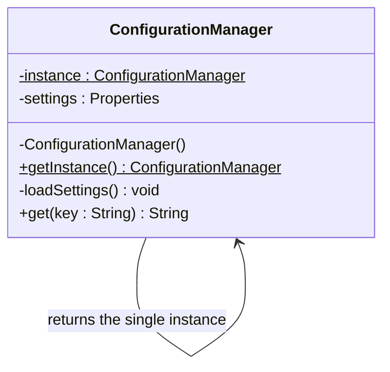

## 1. Most appropriate design pattern

**Singleton Pattern** (Creational design pattern)

---

## 2. Justification

The requirements of the scenario map directly to what Singleton provides:

- **"Load settings only once when the application starts":** the single instance is created once and holds the loaded configuration, so the settings are never re-read.
- **"Different modules must access the same configuration data without creating multiple copies":** every module calls the same global access point, `ConfigurationManager.getInstance()`, and receives the **same object**.
- **"If a module tries to create a new configuration manager, return the existing one":** the **private constructor** blocks `new`, and `getInstance()` always returns the **already existing instance**.

Other benefits:

- **Consistency:** there is one source of truth, so no module sees outdated or different settings.
- **Resource efficiency:** the config file is read and parsed once, with no duplicate copies in memory.
- **Controlled access:** the class itself controls its own creation.

---

## 3. Class structure



---

## 4. Java example

```java
public class ConfigurationManager {
    private static ConfigurationManager instance;
    private final Properties settings = new Properties();

    private ConfigurationManager() {          // private constructor
        loadSettings();                       // runs only once
    }

    public static synchronized ConfigurationManager getInstance() {
        if (instance == null) {
            instance = new ConfigurationManager();
        }
        return instance;
    }

    private void loadSettings() {
        // read the config file here (e.g. app.properties)
    }

    public String get(String key) {
        return settings.getProperty(key);
    }
}

// Any module
String dbUrl = ConfigurationManager.getInstance().get("db.url");
```

The settings are loaded inside the constructor, so loading happens **exactly once**, no matter how many modules call `getInstance()`.
