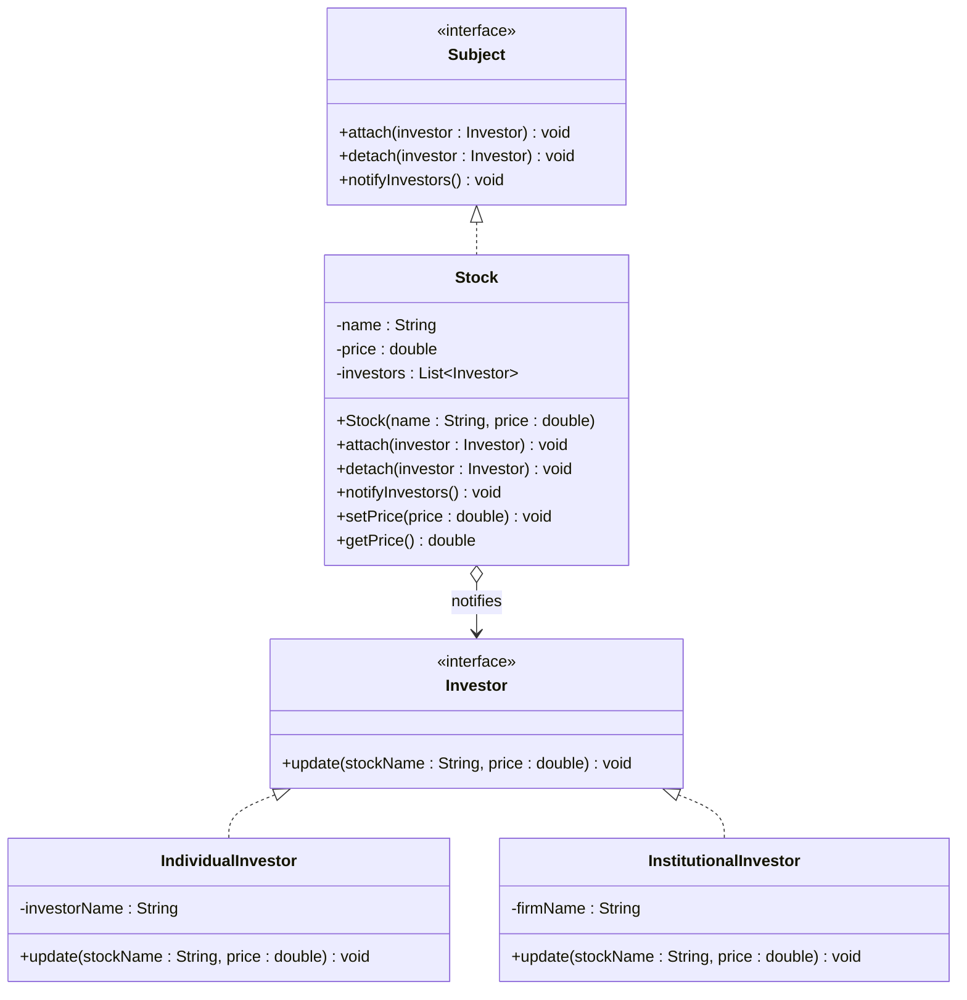

## 1. Suitable design pattern

**Observer Pattern** (Behavioral design pattern)

---

## 2. Justification

- Each stock is the **Subject (Observable)**, and each investor is an **Observer**.
- When a stock's price changes, **all subscribed investors must be notified immediately**. The pattern does this by having the subject call `update()` on every registered observer.
- Investors can **subscribe or unsubscribe dynamically** through `attach()` and `detach()` methods.
- It sets up a **one-to-many dependency**: one stock, many investors.
- The stock does **not need to know the concrete details** of each investor. It only knows they implement the `Investor` interface, so the system stays **loosely coupled**.
- New investor types (e.g. a trading bot or a mobile alert) can be added **without changing the `Stock` class**.
- Only investors subscribed to a particular stock are notified, since each stock keeps its **own list of observers**.

---

## 3. Class structure



**Roles in the pattern:**

| Role | Class |
|---|---|
| Subject | `Subject` (interface) |
| Concrete Subject | `Stock` |
| Observer | `Investor` (interface) |
| Concrete Observers | `IndividualInvestor`, `InstitutionalInvestor` |

**Key relationships:**

- `Stock` keeps a **list of `Investor` objects**.
- `setPrice()` changes the price and then calls `notifyInvestors()`.
- `notifyInvestors()` loops through the list and calls `update()` on each investor.

---

## 4. Java example

```java
import java.util.ArrayList;
import java.util.List;

interface Investor {
    void update(String stockName, double price);
}

interface Subject {
    void attach(Investor investor);
    void detach(Investor investor);
    void notifyInvestors();
}

class Stock implements Subject {
    private final String name;
    private double price;
    private final List<Investor> investors = new ArrayList<>();

    Stock(String name, double price) {
        this.name = name;
        this.price = price;
    }

    public void attach(Investor investor) { investors.add(investor); }
    public void detach(Investor investor) { investors.remove(investor); }

    public void notifyInvestors() {
        for (Investor investor : investors) {
            investor.update(name, price);
        }
    }

    public void setPrice(double price) {
        this.price = price;
        notifyInvestors();               // notify on every change
    }

    public double getPrice() { return price; }
}

class IndividualInvestor implements Investor {
    private final String investorName;

    IndividualInvestor(String investorName) { this.investorName = investorName; }

    public void update(String stockName, double price) {
        System.out.println(investorName + " notified: " + stockName + " is now $" + price);
    }
}

// Usage
Stock apple = new Stock("AAPL", 150.00);
Investor kasun = new IndividualInvestor("Kasun");
Investor nimal = new IndividualInvestor("Nimal");

apple.attach(kasun);
apple.attach(nimal);
apple.setPrice(155.50);    // both notified
apple.detach(nimal);
apple.setPrice(160.00);    // only Kasun notified
```
